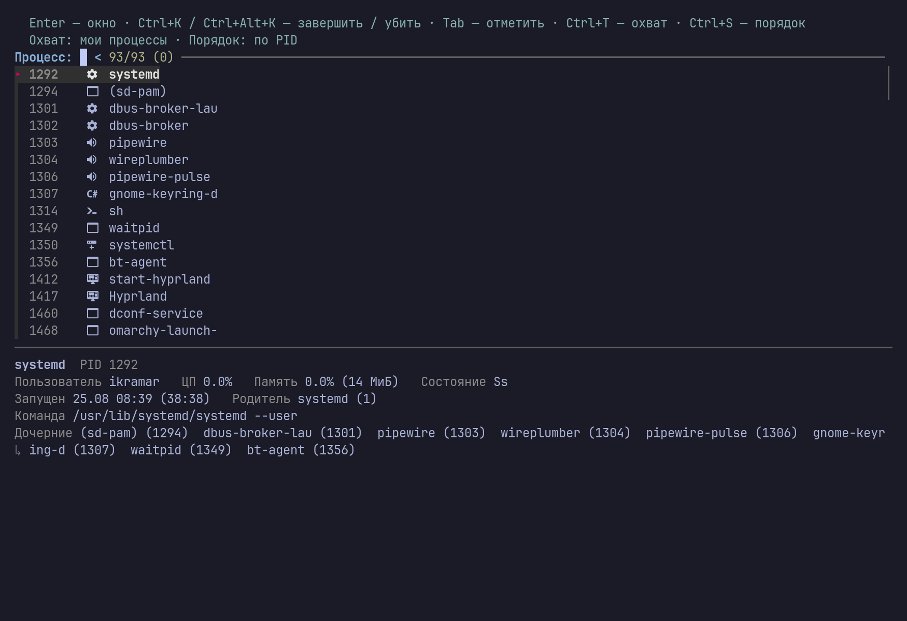
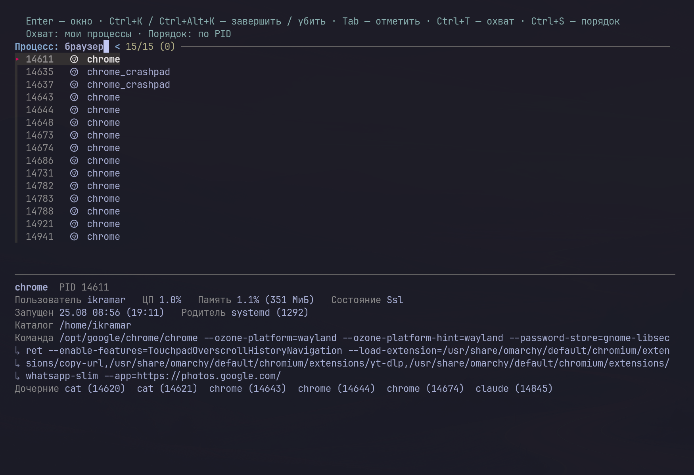
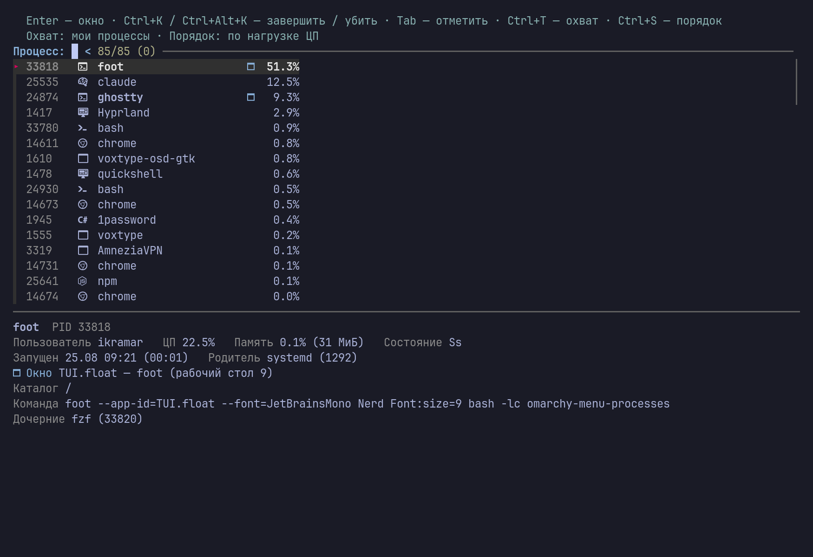

<div align="center">

# Omarchy Processes

**English** · [Русский](README.ru.md)

### Find the process. Focus its window. Free the port.

[](https://github.com/IgorKramar/omarchy-processes/actions/workflows/lint.yml)


[](LICENSE)

[Install](#install) · [Keys](#keys) · [Search](#search) · [Customize](#customize) · [Uninstall](#uninstall)

</div>

**A process picker inside the Omarchy menu.** See a PID, icon, name and listening TCP port; search across hidden details; press `Enter` to focus the process's window.



A system monitor answers “what is consuming resources?” This picker helps answer “where is that application's window?” and “what is listening on this port?” CPU and memory sorting are available when needed.

## Install

Run the installer as your regular user:

```bash
bash <(curl -fsSL https://raw.githubusercontent.com/IgorKramar/omarchy-processes/main/install.sh)
```

It installs `omarchy-menu-processes` into `~/.local/bin`, adds the menu entry and rebuilds the translated menu if [omarchy-ru](https://github.com/IgorKramar/omarchy-ru) is present. Changed files receive timestamped backups; identical files are left alone. Keep `~/.local/bin` in your `PATH`.

To inspect the installer first or select its options:

```bash
git clone https://github.com/IgorKramar/omarchy-processes.git
cd omarchy-processes
./install.sh --help
./install.sh --dry-run
./install.sh --no-deps   # require fzf and jq to be installed already
```

Open **Menu → System → Processes** (the entry is labelled «Процессы») or run:

```bash
omarchy menu summon processes
```

### Requirements

- Omarchy 4 with Hyprland and the Quickshell-based shell.
- `fzf` and `jq`; the installer can install missing packages with `pacman` and `sudo`.
- `ss` from `iproute2` for port information. The list still works without it.
- A Nerd Font in the terminal for icons.
- `hyprctl` for window focusing. Without Hyprland, listing and signalling still work; `Enter` opens process details instead.

## Keys

| Key | Action |
|:---|:---|
| `Enter` | Focus the process's window; walk up its parents if needed; show details if no window exists |
| `Ctrl+K` | Send `SIGTERM` |
| `Ctrl+Alt+K` | Send `SIGKILL` |
| `Tab` | Select multiple processes; the signal is sent to all selected rows |
| `Ctrl+T` | Switch between your processes and all processes |
| `Ctrl+S` | Cycle sorting: PID → CPU → memory |
| `Ctrl+R` | Refresh |
| `Esc` | Exit |

Session-critical processes such as Hyprland, quickshell, systemd, uwsm, dbus and pipewire are protected: signalling is refused and the header explains why. Other applications can lose unsaved work when terminated; `SIGKILL` gives them no cleanup opportunity.

## Search

Search includes more than the visible columns:

| Field | Examples |
|:---|:---|
| PID | `14611` |
| Process name | `chrome`, `quickshell` |
| Icon category | `браузер`, `терминал`, `редактор`, `контейнер`, `звук`, `игра` |
| Command line | `--ozone-platform`, `/usr/lib/systemd` |
| Window class and title | `ghostty`, part of a tab title |
| Listening TCP port | `:3000`, `:5432`, `порт` for listeners |

Icon categories make glyphs searchable without typing the glyph itself. Matching uses exact substrings; space-separated words narrow the result together. The category examples above match the Russian search tags shipped by the application.



Use the colon in `:3000`: a bare number can also match an unrelated argument or PID. Once found, a listener is an ordinary row: `Enter` focuses its window and `Ctrl+K` asks it to stop. Only listening **TCP** sockets are included, not UDP or every established connection. IPv4 and IPv6 duplicates are removed.

Port ownership is normally visible only for your processes. Showing all processes does not elevate `ss`, so system listeners may have no port label.



## How it works

| Component | Responsibility |
|:---|:---|
| [`bin/omarchy-menu-processes`](bin/omarchy-menu-processes) | Bash picker built on `fzf` |
| `ps` + `hyprctl clients -j` | Process rows and window matching |
| `ss -tlpnH` | One snapshot of listening TCP ports, grouped by PID |
| [`menu/system.processes.jsonc`](menu/system.processes.jsonc) | Menu action opening a floating terminal with `app-id=TUI.float` |

Icons and search tags come from exact process names followed by name/window-class patterns. Full rows are filtered with `fzf --filter --exact` before the three display columns are returned; this keeps hidden fields searchable.

Snapshots are cached for three seconds because rebuilding `ps` and window data on every keystroke is expensive. `Ctrl+R` and signalling invalidate the cache. The picker's own helper process chain is hidden to avoid noisy self-measurement.

## Customize

<details>
<summary><strong>Icons and search tags</strong></summary>

Edit `icon_for` in the script. The first `case` matches exact names, the second matches process and window-class patterns:

```bash
*telegram*|*signal*|*discord*) icon="󰭹"; tags="общение chat мессенджер messenger" ;;
```

</details>

<details>
<summary><strong>Window size and key bindings</strong></summary>

Omarchy's `floating-window` rule controls the size. A rule in `~/.config/hypr/` can change `TUI.float` windows:

```lua
o.window("TUI.float", { size = { 1100, 700 } })
```

This class is shared with other floating terminal apps. Key bindings are in the final `fzf` invocation and use the standard `fzf --bind` syntax.

</details>

## Development

```bash
git config core.hooksPath .githooks
shellcheck install.sh uninstall.sh bin/omarchy-menu-processes test/ports.sh
test/ports.sh
```

The commit hook discovers shell scripts by shebang and runs ShellCheck. If ShellCheck is absent, the local hook skips it; CI runs the check explicitly. `test/ports.sh` supplies a fake `ss` to verify IPv4/IPv6 deduplication and `:5432` search. CI also checks Bash syntax and parses the menu entry.

### Menu placement

The entry is appended at the end of **System**, after shutdown actions: the shell loads bundled items before user extensions. Moving it earlier requires cloning and maintaining the shell's `menu` plugin with `omarchy plugin clone`; this installer does not do that.

## Uninstall

From a checkout:

```bash
./uninstall.sh
```

The uninstaller removes the menu entry, `~/.local/bin/omarchy-menu-processes` and the cache. It backs up edited menu files with a timestamp before changing them.

## Related project

[Omarchy RU](https://github.com/IgorKramar/omarchy-ru) provides Russian locale, keyboard layout, translated menus and a shell setup.

## License

[MIT](LICENSE). Copyright © Igor Kramar.
